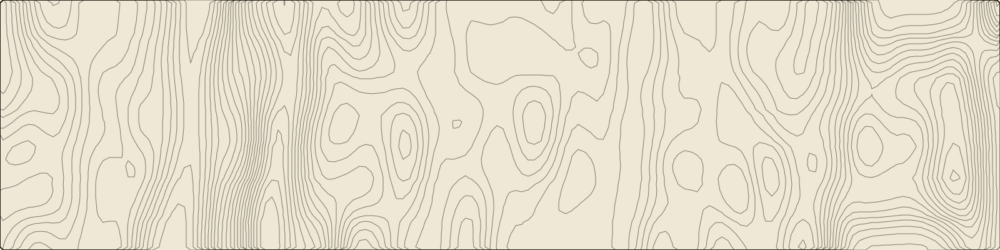
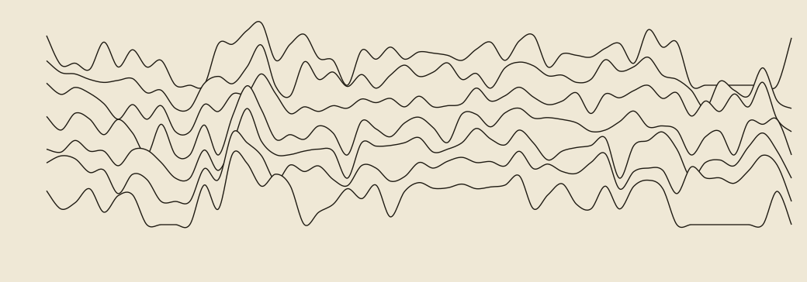
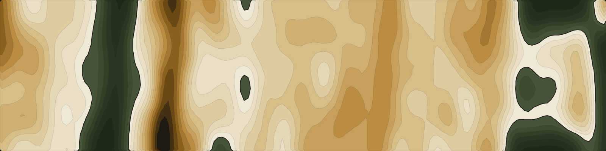

# commit-terrain

Turn a GitHub contribution calendar, or any grid of numbers, into topographic contour lines, ridge lines like an EKG of your year, or an abstract atlas.



It’s the terrain under every page of [kylecrfahey.com](https://kylecrfahey.com): a year of my GitHub contributions, one row per week and one column per weekday, with each day’s count as the height. Busy stretches become ridges and quiet ones flatten into valleys.

It’s a thin, opinionated layer over [d3-contour](https://github.com/d3/d3-contour). The opinions are the useful part:

- **Soft sampling.** Each point is a Gaussian blend of the cells around it, so one busy day becomes a hill instead of a spike.
- **Log scaling.** One 80-commit day doesn’t flatten the rest of the year.
- **Even levels** between zero and the peak, returned lowest first, ready to drop into SVG.

## Install

```sh
npm install github:quesurifn/commit-terrain
```

## Try it

```sh
GITHUB_TOKEN=... npx github:quesurifn/commit-terrain <your-github-login> --atlas > atlas.svg
```

Any token works, because the contribution calendar is public. Private contributions show up as counts if you’ve turned on “Include private contributions” in your GitHub profile settings. Swap `--atlas` for `--across` (contours), `--ridges` (the EKG), or nothing at all for a tall contour version with weeks running down the page.

## Use it

```js
import { fetchContributions, terrain, toSvg } from 'commit-terrain';

const { weeks } = await fetchContributions('quesurifn', { token: process.env.GITHUB_TOKEN });
const t = terrain(weeks); // { width, height, paths: string[] }
const svg = toSvg(t, { stroke: '#1E1A12', background: '#EFE8D6' });
```

`paths` is one SVG path `d` string per contour level, so you can render them however you like. On the site they sit in a fixed `<svg>` behind the page, drawn in `currentColor` so the lines follow the page’s palette:

```jsx
<svg viewBox={`0 0 ${t.width} ${t.height}`} preserveAspectRatio="xMidYMin slice">
  <g fill="none" stroke="currentColor">{t.paths.map((d) => <path d={d} />)}</g>
</svg>
```

It runs anywhere JavaScript does. The site computes it once at build time, so visitors download plain SVG.

### Ridge lines



`ridges(weeks)` draws one smooth line per weekday, rising with each week’s work. Each line comes with an `area` that closes down to a floor; fill it with your background and draw back to front, and the nearer ridges hide the ones behind. `--ridges` on the CLI does exactly that.

### Atlas



The geography of your commits, kept abstract. `atlasToSvg(terrain)` fills the contours like a relief map in earth tones: the quietest stretches settle below a coastline as deep moss, and work rises from bone through sand and ochre to ink at the busiest peaks. `seaLevel` (default `0.3`) is the share of levels underwater; `water` and `land` take your own color stops. `--atlas` on the CLI.

## API

### `terrain(grid, options?)`

`grid` is an array of rows. Rows run down (y) and columns across (x). A GitHub calendar from `fetchContributions` is weeks × 7 days, so by default weeks run down the page. Use `transpose(weeks)` to lay them across, like GitHub does.

| Option | Default | |
|---|---|---|
| `width`, `height` | `1600`, `4800` | Output size in SVG units |
| `resolution` | `96` | Sample columns across the width; rows follow the aspect ratio |
| `levels` | `22` | Contour lines between zero and the peak |
| `scale` | `'log'` | `'log'`, `'linear'`, or a function |
| `radius` | `[2, 1]` | Smoothing kernel radius in cells, `[rows, columns]` |
| `spread` | `[1.6, 0.9]` | Kernel softness, `[rows, columns]`; larger is softer |
| `precision` | `0` | Decimal places in path coordinates |

When you transpose, swap the kernel too (`radius: [1, 2], spread: [0.9, 1.6]`), so the smoothing still runs mostly along the weeks.

### `ridges(grid, options?)`

One ridge per column. Options: `width` (1040), `gap` (30), `amplitude` (92), `top` (110), `left` (60), `right` (20), `depth` (40), `scale` (`'log'`), `precision` (1). Returns `{ width, height, x, lines }`, where `x(row)` gives a row’s position for axis marks, and each line has `d`, `area` and its baseline `y`.

### `ridgesToSvg(ridges, options?)`

A standalone SVG string. Options: `stroke`, `strokeWidth`, `background`.

### `atlasToSvg(terrain, options?)`

A standalone SVG string. Options: `seaLevel` (0.3), `water` (stops, deepest first), `land` (stops, coast to peak), `coast`, `stroke`.

### `toSvg(terrain, options?)`

A standalone SVG string. Options: `stroke`, `strokeWidth`, `strokeOpacity`, `background`.

### `fetchContributions(login, { token, fetch? })`

Your last year from GitHub’s GraphQL API: `{ total, start, weeks }`. `token` defaults to `GITHUB_TOKEN`.

### `transpose(grid)`

Swaps rows and columns.

## License

MIT, by [Kyle C. R. Fahey](https://kylecrfahey.com).
